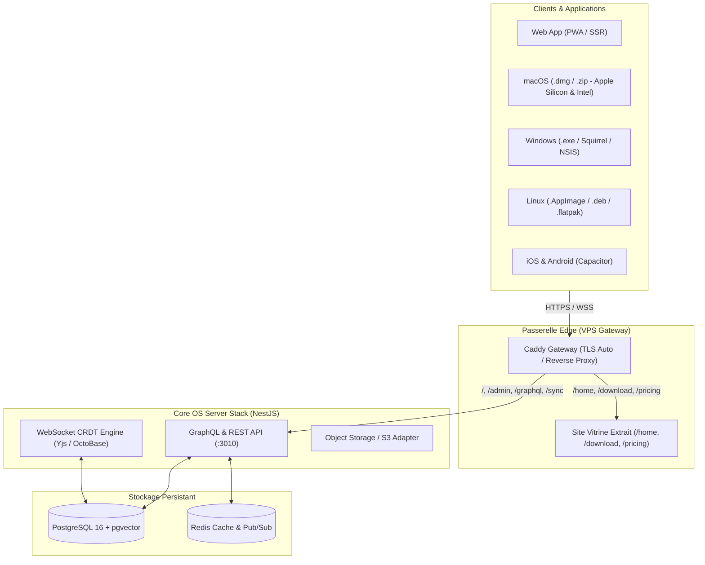

# Claranote — Base de connaissances open-source & Espace de travail autonome

[](https://claranote.com)
[](https://github.com/claragram/claranote)
[](LICENSE)

**Claranote** est une suite de productivité tout-en-un, souveraine, locale-d'abord (*local-first*) et assistée par l'intelligence artificielle, combinant documents structurés (type Notion), tableaux infinis (type Miro) et bases de données relationnelles dans un espace unifié.

---

## 🏛 Architecture Globale



---

## 📦 Composants du Dépôt

| Répertoire | Description |
| :--- | :--- |
| **`codebase/packages/frontend/core`** | Interface principale Notion-like (éditeurs de blocs, tableaux blancs infinis, vues bases de données). |
| **`codebase/packages/frontend/admin`** | Console d'administration Claranote avec passerelle directe vers l'espace de travail. |
| **`codebase/packages/frontend/apps/electron`** | Application de bureau multi-plateforme (Windows, Mac, Linux) avec persistance SQLite locale. |
| **`codebase/packages/frontend/apps/ios`** | Application mobile iOS native. |
| **`codebase/packages/frontend/apps/android`** | Application mobile Android native. |
| **`codebase/packages/backend/server`** | Serveur d'entreprise NestJS, moteur de synchronisation CRDT temps réel et API GraphQL. |
| **`codebase/blocksuite`** | Moteur d'édition de blocs haute performance BlockSuite. |
| **`deploy/`** | Déploiement de production Docker Compose, configuration Caddy avec SSL automatique pour `claranote.com`. |
| **`deploy/website/`** | Site marketing complet extrait et rebrandé (`index.html`, `download/`, `pricing/`, assets, polices, styles). |
| **`scripts/`** | Outils d'extraction de site et d'automatisation de maintenance. |

---

## 🚀 Déploiement en Production (VPS)

La pile de production tourne sous Docker avec haute disponibilité et auto-guérison :

```bash
# Déploiement direct depuis la racine :
./deploy/deploy.sh
```

### Endpoints de Production
- **Espace de Travail Cloud :** [https://claranote.com/](https://claranote.com/) (ou `http://192.168.1.16:3010/`)
- **Site Vitrine & Marketing :** [https://claranote.com/home](https://claranote.com/home)
- **Téléchargement des Applications :** [https://claranote.com/download](https://claranote.com/download)
- **Tarifs & Éditions :** [https://claranote.com/pricing](https://claranote.com/pricing)
- **Console d'Administration :** [http://192.168.1.16:3010/admin](http://192.168.1.16:3010/admin)
- **API GraphQL :** `http://192.168.1.16:3010/graphql`

---

## 💻 Compilation des Applications de Bureau (Desktop)

Les applications de bureau supportent le mode **100% hors-ligne (*local-first*)** avec fusion automatique des conflits dès reconnexion au serveur via les CRDTs Yjs / OctoBase.

```bash
cd codebase/packages/frontend/apps/electron

# Lancement en mode développement local :
yarn dev

# Packaging pour la plateforme active :
yarn package

# Génération des installateurs de production :
# - macOS : .dmg & .zip (Universal, arm64, x64)
# - Windows : .exe (Squirrel & NSIS)
# - Linux : .AppImage, .deb, .flatpak
yarn make
```

---

## 📡 API & Synchronisation Temps Réel

Le schéma GraphQL complet est disponible dans [`codebase/packages/backend/server/src/schema.gql`](codebase/packages/backend/server/src/schema.gql).

### Capacités clés de l'API
- **Workspaces & Collaboration :** Création, invitation de membres, permissions RBAC d'équipes.
- **Moteur CRDT Temps Réel :** Synchronisation bidirectionnelle via WebSockets (`/sync`) avec Yjs.
- **Stockage Blobs & Médias :** Téléversement optimisé vers adaptateur local ou S3/MinIO compatible.
- **Gestion des Licences :** Quotas multi-niveaux et abonnements d'équipe.

---

## 🛡 Séparation Contrôle / Données (Directives Claranote)

Conformément à l'architecture souveraine Clara :
- **Plan de Contrôle (Interne) :** Hébergé sous `claralogy.com` (administration système, daemons, orchestration).
- **Plan de Données (Public / SaaS) :** Exposé sur `claranote.com` (espace de travail utilisateur, vitrine commerciale et APIs publiques).
